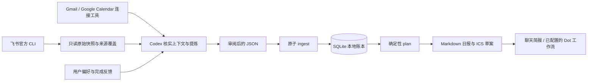

# 架构与数据约定

本项目把模型判断与可重复执行的本地操作分开：Codex 决定哪些信息值得行动，Python 验证并保存结果，然后按明确的工作时间和已知日程排程。



## 组件

| 文件 | 职责 |
| --- | --- |
| `assistant.py` | 配置验证、SQLite、导入、状态更新、排程及输出 |
| `collect_feishu.py` | 调用已有的官方原生 CLI，采集四类只读来源 |
| `run-assistant.ps1` | Windows Python 运行时选择，不修改 PATH |
| `install_skill.py` | 将可复用技能安装到选定位置并绑定项目根目录 |
| `skill/personal-assistant/` | Codex 的来源读取、事实提炼、主动简报与操作约定 |

没有额外模型服务或常驻进程。定时由宿主应用执行；安装技能不会自动创建定时任务。

## 本地状态

SQLite 的 `sources`、`goals`、`tasks`、`events` 表按稳定 ID 保存 JSON 记录，`history` 保存变更。`ingest` 在校验整个批次后通过事务提交；无效来源、目标引用或记录会使整批失败。

重复的相同 ID 更新原记录。导入旧消息不会把 `done` / `cancelled` 任务重新设为活动状态；重开需要明确的新事实和用户意图，由 `update --status todo` 或显式 `reopen:true` 表达。稳定 ID 防止同一事项重复，不意味着跨服务的同名任务可以盲目合并。

## 导入 envelope

顶层支持 `sources`、`goals`、`tasks`、`events` 和可选 `calendar_snapshots`。日期时间必须包含时区，例如 `2026-11-11T10:00:00+08:00` 或 `2026-11-11T02:00:00Z`。缺失的任务截止是 `null`，不从模糊的“下午”“周报”猜日期。

以下是**人工构造的格式示例**，不代表任何人的真实工作。保存到自行创建的 `reviewed-summary.json` 并导入会产生一个示例任务；实际使用时应替换成核实后的内容。

```json
{
  "sources": [
    {
      "id": "manual",
      "status": "ok",
      "observed_at": "2026-11-11T09:00:00+08:00",
      "scope": "本人在本次聊天中明确交代的一项工作"
    }
  ],
  "tasks": [
    {
      "id": "manual:sample-review",
      "title": "整理测试结果与一个待解决问题",
      "source": "manual",
      "source_ref": "人工样例：当前聊天中的本人任务",
      "evidence": "本人要求整理本次测试结果；估时属于助理建议。",
      "owner": "self",
      "status": "todo",
      "confidence": 0.95,
      "importance": 4,
      "estimate_minutes": 30,
      "due_at": null,
      "goal_id": null
    }
  ]
}
```

### 来源与任务

`sources` 必需字段为 `id,status,observed_at,scope`，可补 `details`。

| `status` | 含义 |
| --- | --- |
| `ok` | 明确写在 `scope` 中的有限范围完整成功 |
| `partial` | 页数、会话、时间或查询结构仍有未确认覆盖 |
| `unavailable` | 未授权、权限不足、认证失败、无法启动或读取失败 |

一次成功搜索只证明搜索范围，不证明读完所有会话。来源覆盖记录包含采集时间；消息/日程发生时间应保留在证据与对应字段中，不能混为一个时间。

任务需包含示例中的字段。`owner` 为 `self` 或 `profile.aliases` 中已确认的本人称呼时才可自动排程；未知责任人为 `null`。`status` 支持 `todo/waiting/done/cancelled`；`confidence` 为 0–1，`importance` 为 1–5 整数，估时为 5–4800 的整数分钟。低置信度、非本人及 `waiting` 事项不占自动专注块。

目标使用 `id,title,status`，其中状态为 `active/paused/done/cancelled`，可补 `evidence` 与真实的 `target_date:YYYY-MM-DD`。任务的 `goal_id` 只能引用已有目标。岗位描述不自动构成已承诺的季度目标。

### 日程与完整快照

`events` 必需 `id,title,source,start,end`，可补 `source_ref,status,transparency`。状态为 `confirmed/tentative/cancelled`，透明性为 `opaque/transparent`；取消或透明日程不占忙碌时间。全天事件由提炼者按来源时区转换成真实起止范围。

完整快照可撤销该来源、该窗口内已经不存在的旧忙碌项：

```json
{
  "source": "feishu_calendar",
  "start": "2026-11-11T00:00:00+08:00",
  "end": "2026-11-12T00:00:00+08:00",
  "complete": true
}
```

它应作为 `calendar_snapshots` 数组的一项，与该来源本批 `status=ok` 记录及整个窗口的完整 `events` 一起提交。只有确实读完相关日历、分页和重复实例时才使用；仅主日历、失败或部分结果不可清除其他未读日历的旧记录。程序验证状态一致性，采集范围是否真的完整仍取决于读取证据。

## 排程规则

配置决定时区、ISO 星期数字 `workdays`、非重叠 `work_windows`、容量比例与置信度门槛。默认预算为扣除已知忙碌后的可用时间的 70%，按五分钟对齐。任务按目标、重要性与明确截止选择，同时优先保护当天可达到的较早截止，避免长任务挤掉本能按时完成的工作。

计划不会排入过去、休息、非工作日或已导入的忙碌时间。单段最多 90 分钟不代表自动安排了额外休息；工作窗口和保留容量仍需根据实际情况配置。容量不足的工作进入未安排清单，明确的延期风险会提示。

## 采集约束

采集器寻找已安装的原生 `lark-cli`，不通过 JS 启动器自动下载程序，也不发起认证。它固定 `--as user`，不因用户令牌缺失切换为 Bot。每来源最多 45 秒、合计 stdout/stderr 2 MiB；消息、任务和邮件列表请求最多五页，agenda 无法确认完整结构时保持部分覆盖。四类来源最多四路并发。

成功 JSON 以原始资料快照落盘，已知凭据键和认证 URL 会脱敏；原始错误文本不保存，只保留有限、经过校验的错误分类。**脱敏不等于公开可分享**：正常消息正文、姓名和公司信息仍可能是私人数据，因此整个 `data/` 都应保持私有。

仅来源覆盖会自动导入。原始消息不会直接成为任务，邮箱列表不会直接产生邮件摘要，日历不明结构不会被当作完整快照。Gmail / Google Calendar 的读取由 Codex 插件承担，遵循相同的来源和提炼规则。
